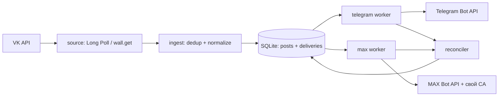

**Технический план реализации, редакция 9**


| Версия плана | 9.0                                                                                                                                                           |
| ------------ | ------------------------------------------------------------------------------------------------------------------------------------------------------------- |
| База         | ТЗ «Crosspost — VK → MAX + Telegram.md» v0.1                                                                                                                  |
| Размещение   | Docker на VDS, Нидерланды                                                                                                                                     |
| Источник     | VK, сообщество `227892646` (`dilerfavoritavto42`)                                                                                                             |
| Статус       | локально проверены приём VK → нормализация → SQLite, базовые операции Telegram delivery, TelegramPublisher и MediaDownloader. Для video attachment нормализатор формирует постоянную ссылку VK; тест нормализации пройден. Telegram worker и MAX publisher/worker ещё не реализованы |


1. Зафиксирована единая политика предварительного отбора VK-видео: до скачивания получить метаданные через `yt-dlp`; если размер каждого видео ≤ 49 МБ — скачать и отправлять нативно; если > 49 МБ — не скачивать, публиковать ссылку на исходное видео VK; если размер определить нельзя — не скачивать вслепую, сохранять ссылку. Каждое видео в посте обрабатывается независимо.
2. Для каждого видео в SQLite предусматриваются `file_size`, `status`, `media_type` (`video` или `link`), `original_url`, `file_path` (NULL, если скачивания не было).
3. Подтверждена отправка тестового фото с текстом в Telegram через Bot API.
4. Подтверждена отправка локального MP4-файла `media/file_example_MP4_1280_10MG.mp4` через `aiogram` `send_video()` с `FSInputFile`; Telegram принял файл, он отображается как видео со встроенным плеером.
5. На реальном VK-сообществе подтверждены `wall.get`, структура фото `photo.sizes` и получение метаданных видео через `video.get`.
6. Для фото подтверждена загрузка полного файла с CDN VK. Для видео подтверждено извлечение DASH MPD и HLS через `yt-dlp`; реальный MP4 успешно скачан в качестве до 720p.
7. `video.get.direct_url` уточнён: в проверенном случае это страница просмотра `vkvideo.ru`, а не прямой URL видеофайла.
8. `yt-dlp` и FFmpeg используются для получения видео из VK; FFmpeg нужен для объединения раздельных аудио- и видеопотоков. Перекодирование видео не планируется.
9. MAX: подтверждены TLS с отдельным `cert/max-ca.pem`, авторизация бота (`GET /me`), доступ к каналу (`GET /chats/{chat_id}`), членство и права администратора (`GET /chats/{chat_id}/members/me`).
10. MAX: успешно выполнена реальная публикация JPG в канал через `POST /uploads` и `POST /messages`; получен `message.body.mid`. Публикация видео в MAX пока не проверена.
11. VK использует **сервисный ключ с правами только на чтение**; ключ с правами записи не требуется.
12. Снят риск сборки альбомов: запись VK приходит одним объектом.
13. Хост рассматривается как «Docker + сеть».
14. Диагностические скрипты VK вынесены из `src/crosspost/vk/` в `scripts/vk/`; в пакете оставлены переиспользуемые модули `client.py`, `normalize.py`, `media.py` и `__init__.py`.
15. `MediaDownloader` выделен в `src/crosspost/vk/media.py`. Проверены потоковая загрузка, временный `.part`, атомарная замена и сохранение старого файла при сетевой ошибке; 5 unit-тестов проходят.
16. `normalize_post()` формирует для video attachment `original_url` вида `https://vk.com/video{owner_id}_{video_id}`. Отдельный тест на видео VK `-227892646_456239081` прошёл; скачивание видео при нормализации не выполняется.

---

## Содержание

1. Назначение и границы
2. Входные данные и статус проверки
3. Архитектура
4. Структура каталогов
5. Назначение модулей
6. Внешние зависимости и конфигурация
7. Этапы реализации
   - 7.1. Фактический статус локальной разработки
8. Риски и способы устранения
9. Быстрый переезд
10. Открытые вопросы
11. Приложение: реестр проверки API
   - 11.4–11.7. Дополнительные проверки и локальная реализация
12. Пример конфигурации `.env.example`

---

## 1. Назначение и границы

VK — единственный первоисточник. Сервис обнаруживает новую публикацию сообщества и публикует её в канал MAX и канал Telegram. Один контейнер, одна очередь публикаций, четыре статуса доставки на площадку.

```
VK → Crosspost → MAX
              ↘ Telegram
```

**Обязательно по требованию заказчика:** перенос фотографий **и видео**, с сохранением оформления — переносы строк, ссылки, эмодзи, порядок медиа, репосты контентом оригинала.

**Политика отбора:** любое новое сообщение, без тематического фильтра.

**Автономность (жёсткое ограничение):** приложение не изменяет системные настройки сервера, firewall, маршрутизацию и системный CA bundle; не публикует входящих портов; не хранит секреты в образе.

---

## 2. Входные данные и статус проверки

### 2.1. Подтверждено официальной документацией

| Параметр | Значение | Источник |
|---|---|---|
| VK Long Poll покрывает активность на стене | да | dev.vk.com/ru/api/events/overview |
| `wall.get`: сервисный ключ; `count` ≤ 100; `domain` принимает короткий адрес | да | dev.vk.com/ru/method/wall.get |
| `wall.getById`: ≤ 100 ID; `copy_history_depth` для репостов | да | dev.vk.com/ru/method/wall.getById |
| Telegram: текст сообщения | 1–4096 символов | Bot API, `sendMessage` |
| Telegram: подпись к медиа | 0–1024 символа | Bot API, `InputMediaPhoto` |
| Telegram: альбом | 2–10 элементов, возвращает **массив** Message | Bot API, `sendMediaGroup` |
| Telegram: форматирование | MarkdownV2 / HTML: bold, italic, underline, strike, spoiler, blockquote, ссылки, pre/code | Bot API, Formatting options |
| MAX: текст | до 4000 символов | dev.max.ru, `NewMessageBody` |
| MAX: изображение | JPG/JPEG/PNG/GIF/TIFF/BMP/HEIC; ≤ 50 МБ **и** ≤ 7680×7680 — оба критерия | dev.max.ru, «Типы вложений» |
| MAX: видео | MP4/MOV/MKV/WEBM; ≤ 250 МБ | там же |
| MAX: вложений в сообщении | ≤ 12 | dev.max.ru, `POST /messages` |
| MAX: частота | ≤ 2 сообщения/сек в один чат | там же, «Ограничения» |
| MAX: медиа | `POST /uploads` → `token`; один файл на URL загрузки; **изображения можно по `url`, видео/аудио — нельзя** | dev.max.ru, `POST /uploads`; «Отправка сообщений с медиафайлами» |
| MAX: авторизация | только заголовок `Authorization` | dev.max.ru, «Обзор» |
| MAX: TLS | домен `platform-api2.max.ru`; требуется **сертификат Минцифры** в доверенных | dev.max.ru, «Обзор» |

### 2.2. Проверено на живом VK API и загрузке медиа

Проверки выполнены на стене сообщества `-227892646` с сервисным ключом только для чтения.

| Проверка | Фактический результат | Статус |
|---|---|---|
| `wall.get` | Возвращает записи сообщества; в `attachments[]` обнаружены фото, видео и ссылки | подтверждено |
| Фото | `photo.sizes` содержит варианты размеров и URL; выбор максимального по `width × height` работает | подтверждено |
| Фото CDN | Для фото `456245152` выбран вариант 1424×1920; CDN ответил JPEG и `Content-Range: bytes 0-0/866015`; полный файл затем успешно скачан | подтверждено |
| Видео | `video.get` по `owner_id`, `id` и `access_key` вернул метаданные; поле `files` в проверенном ответе отсутствовало | подтверждено для проверенного видео |
| `direct_url` | В проверенном случае ведёт на страницу `vkvideo.ru/video-227892646_456239081`, а не на MP4 | подтверждено |
| Извлечение потока | `yt-dlp --list-formats` обнаружил DASH MPD и HLS; доступны варианты до 1280×720 | подтверждено для проверенного видео |
| Скачивание видео | Команда `yt-dlp` с FFmpeg успешно скачала и объединила видео в MP4 | подтверждено для проверенного видео |
| Telegram `send_photo` | Тестовое фото с текстом успешно отправлено в настроенный канал | подтверждено |
| Telegram `send_video` | Локальный MP4 `media/file_example_MP4_1280_10MG.mp4` успешно отправлен через `aiogram.send_video()` и `FSInputFile`; в Telegram отображается как видео со встроенным плеером | подтверждено |
| Универсальный загрузчик | `MediaDownloader` прошёл unit-тесты фото, видео, HTTP 404, замены файла и сетевого обрыва; при обрыве старый файл сохраняется, временный удаляется | подтверждено тестами |
| MAX TLS | `httpx` с `verify="cert/max-ca.pem"` получил HTTP 404 от `https://platform-api2.max.ru/`; TLS handshake прошёл. Системное хранилище CA без этого bundle соединение не проверило | подтверждено |
| MAX авторизация | `GET /me` вернул HTTP 200; бот `Фаворит`, user ID `251408027`, username `id4211022360_bot`, `is_bot=true` | подтверждено |
| MAX чат | `GET /chats/-72551466963518` вернул HTTP 200; название `Фаворит АВТО`, тип `channel` | подтверждено |
| MAX членство и права | `GET /chats/-72551466963518/members/me` вернул HTTP 200; бот — администратор, в permissions присутствует `write` | подтверждено |
| MAX фото | JPG `media/test.jpg` (0,18 МБ) загружен и опубликован в канал; `POST /uploads` и `POST /messages` завершились успешно, в ответе получен `message.body.mid` | подтверждено |
| MAX видео | Реальная загрузка и публикация видео ещё не выполнены | не проверено |

Подтверждение относится к конкретным проверенным записям и не доказывает одинаковое поведение всех типов видео, приватных записей или ограниченных по доступу материалов.

### 2.3. Остаётся гипотезой — проверяется на живом API

1. Имя и полная схема события создания записи на стене VK (Long Poll).
2. Универсальность схемы вложений для всех типов публикаций, включая `copy_history` и редкие типы attachments.
3. Предельная глубина `offset` в `wall.get`.
4. Происхождение и контроль обновления сертификатов Минцифры (локальная проверка Root CA + Sub CA и TLS с `cert/max-ca.pem` пройдены; официальная процедура ротации ещё не оформлена).
5. Группировка нескольких медиа в один пост MAX (публикация одиночного фото подтверждена; пакетная публикация ещё не проверена).
6. Лимит частоты Telegram-бота.
7. Чтение истории канала Telegram ботом — метода не найдено; считать невозможным до доказательства обратного.
8. Поведение Telegram Bot API при передаче VK URL для разных типов медиа и ограничения размера/доступности таких URL.
9. Возможность стабильного скачивания всех поддерживаемых типов VK-видео через `yt-dlp` без дополнительных cookies/авторизации.

> **Правило:** пункты 2.3 не кодируются «по памяти». Этап, зависящий от гипотезы, начинается с записи реального ответа API или результата проверки в `docs/05-api-verification.md`.

### 2.4. Идентификаторы площадок (зафиксированы заказчиком)

| Назначение | Значение | Где в конфиге | Примечание |
|---|---|---|---|
| Сообщество VK, короткое имя | `dilerfavoritavto42` | `VK_GROUP_DOMAIN` | для `wall.get` (`domain=`) |
| Сообщество VK, числовой ID | `227892646` | `VK_GROUP_ID` | часть ключа дедупликации |
| Владелец стены VK | `-227892646` | вычисляется | `owner_id`, отрицательный ID сообщества |
| Канал MAX | `-72551466963518` | `MAX_CHAT_ID` | передаётся как `chat_id` |
| Канал Telegram | `-1004449971245` | `TG_CHAT_ID` | передаётся как `chat_id` |

**Статус идентификаторов:** `TG_CHAT_ID=-1004449971245` взят из актуального `.env.example`; тестовая отправка в Telegram прошла успешно. `MAX_CHAT_ID=-72551466963518` подтверждён запросом `GET /chats/{chat_id}`: это канал `Фаворит АВТО`, тип `channel`. Для MAX также проверено членство бота и разрешение `write`.

**Требования к правам:** боты Telegram и MAX должны быть администраторами целевых чатов с правом публикации. Токены и ID — только в `.env` (права `600`); сами ID не являются секретом, но в репозиторий не выносятся.

---

## 3. Архитектура

### 3.1. Форма

Один контейнер, один процесс, один asyncio-loop. Компоненты общаются через SQLite (транзакционный outbox), а не напрямую.



**Приём поста и создание по строке-заданию на каждую площадку — одна транзакция.** Отправка — отдельный шаг, меняющий только свою строку. Отсюда независимость площадок (ТЗ §5.4) и защита от повторов (§6).

### 3.2. Источник VK

- Основной канал — **Long Poll** (подтверждено: покрывает активность на стене, не требует входящего порта).
- **Догон при старте** и при потере offset — `wall.get` с `domain=dilerfavoritavto42`, `count=100`, `offset` в пределах проверенной глубины.
- **Репосты** — `wall.getById` с `copy_history_depth=1`: контент берётся из оригинала, текст-надстройка идёт первым блоком.
- Callback не используется: требует публичного HTTPS-эндпоинта.
- **Запись VK приходит одним объектом.** Все вложения одной публикации находятся в одном элементе `items[]`.

### 3.3. Медиа и оформление

**Политика обработки видео единая для целевых площадок и применяется к каждому видео отдельно.**

**Видео VK — обязательный алгоритм:**

1. Получить метаданные каждого видео через `yt-dlp` без скачивания (`extract_info`/эквивалент с `download=False`).
2. Определить размер по доступным метаданным. Для реализации использовать фактически доступное поле размера (`filesize` либо `filesize_approx`); конкретное поле и приоритет должны быть проверены на реальных ответах `yt-dlp`.
3. Если размер ≤ 49 МБ включительно — скачать видео, затем отправить его нативно на целевые площадки.
4. Если размер > 49 МБ — не скачивать; опубликовать ссылку на исходное видео VK.
5. Если размер определить не удалось — безопасный сценарий: не скачивать; сохранить и опубликовать ссылку на исходное видео VK.
6. Если в одной публикации несколько видео, каждый элемент проходит этот алгоритм независимо. Например: 30 МБ — скачать; 75 МБ — ссылка; 49 МБ — скачать.
7. Ссылка должна вести на исходное видео VK, а не на URL промежуточного сервиса скачивания, CDN или временный URL потока.

Порог 49 МБ намеренно ниже лимита облачного Telegram Bot API. В коде порог должен быть одной конфигурационной константой, применяемой до начала скачивания. Для размера, который yt-dlp не смог определить, запрещено запускать скачивание «на всякий случай».

**Фото и площадки:**

- **Telegram:** фото скачиваются с CDN VK и отправляются нативно через `send_photo`; видео, прошедшие предварительную проверку размера (≤ 49 МБ), скачиваются и отправляются через `send_video`.
- **MAX:** нативная публикация фото проверена на реальном канале через `POST /uploads` → `POST /messages`. Нативная публикация видео поддерживается API по документации, но фактический тест в проекте ещё не выполнен. До прохождения теста видео следует публиковать ссылкой на оригинал VK.
- **MAX:** для будущей нативной отправки видео действует тот же проектный порог 49 МБ; более крупные видео не скачиваются, даже несмотря на больший документированный лимит MAX.
- Исходное видео не перекодируется и не ухудшается ради соблюдения лимитов. Локальный Telegram Bot API Server не разворачивается.

Ссылка на исходное видео должна сохраняться в модели каждого медиа как `original_url`. Ссылка на исходную публикацию VK сохраняется отдельно как `source_url`. Это разные сущности: `source_url` относится ко всему посту, `original_url` — к конкретному видео. Для ссылки нельзя использовать `video.get.direct_url`, если он ведёт на промежуточную страницу/поток, а не на устойчивую страницу исходного видео VK.

**Хранение медиа и SQLite:**

Для каждого видео создаётся отдельная запись медиа, чтобы несколько видео одного поста обрабатывались независимо. В записи предусматриваются поля:

| Поле | Назначение |
|---|---|
| `file_size` | размер видео, полученный из метаданных до скачивания; NULL, если определить не удалось |
| `status` | состояние обработки конкретного медиа; набор значений будет зафиксирован при проектировании схемы |
| `media_type` | `video` — скачиваемый файл; `link` — публикация ссылкой |
| `original_url` | постоянная ссылка на исходное видео VK |
| `file_path` | путь к локальному файлу; NULL, если скачивание не выполнялось |

Для медиа типа `link` поле `file_path` обязательно NULL. Не создавать пустые или фиктивные файлы. Большие видео и видео с неизвестным размером не должны попадать в каталог загрузок.

**Сценарии:**

| Сценарий | Telegram | MAX |
|---|---|---|
| Фото | Скачать с CDN VK и отправить через `send_photo`; тест пройден | Нативная загрузка через `POST /uploads` и публикация через `POST /messages`; тест JPG пройден |
| Видео ≤ 49 МБ | Скачать через `yt-dlp` и отправить через `send_video`; локальная отправка MP4 проверена, цепочка VK → Telegram ещё не реализована | После проверки видео: скачать и отправить нативно; до проверки — ссылка |
| Видео > 49 МБ | Не скачивать; опубликовать ссылку на исходное видео VK | Не скачивать; опубликовать ссылку на исходное видео VK |
| Размер не определён | Не скачивать; опубликовать ссылку на исходное видео VK | Не скачивать; опубликовать ссылку на исходное видео VK |
| Ошибка скачивания/отправки | Сохранить ссылку на VK и зафиксировать причину в логе | Сохранить ссылку на VK и зафиксировать причину в логе |

**Резервный путь получения медиа из VK:**

- Фото: взять лучший доступный вариант из `photo.sizes` и скачать через `MediaDownloader`.
- Видео: сначала только метаданные через `yt-dlp`, без скачивания; скачивание разрешено лишь после подтверждения размера ≤ 49 МБ.
- FFmpeg нужен для объединения раздельных аудио- и видеопотоков в MP4. Перекодирование не выполнять.
- `video.get.direct_url` нельзя считать прямой ссылкой на файл: в проверенном случае это страница просмотра VK.
- Если метаданные не содержат надёжного размера, не скачивать видео; использовать `original_url`.
- Скачивание должно быть потоковым и атомарным: временный файл `.part`, затем `os.replace`; при ошибке временный файл удаляется, существующий файл назначения не повреждается.
- Для отправки локального видео в Telegram использовать `aiogram` `send_video()` с `FSInputFile`. Этот способ проверен на локальном тестовом MP4; интеграция VK → Telegram ещё должна быть реализована.
- Для MAX фото использовать подтверждённый двухшаговый сценарий: получить URL через `POST /uploads`, загрузить файл, извлечь токен из ответа и отправить вложение через `POST /messages`. Для фото фактическая структура ответа загрузки: `photos` → числовой ключ (`"0"`) → `token`. Не считать эту структуру проверенной для видео.
- MAX видео: структура ответа upload и фактическая публикация должны быть проверены отдельным тестом до включения в worker.
- При невозможности скачивания/публикации сохранять ссылку на VK и фиксировать причину в логе; не терять сам пост.

Ограничения целевых API для выбранной политики:

| | Telegram | MAX |
|---|---|---|
| Фото | Нативная загрузка через Bot API; тест `send_photo` пройден | Нативная загрузка через `POST /uploads` + `POST /messages`; тест JPG пройден |
| Видео | Нативная загрузка по проектному порогу ≤ 49 МБ; локальный MP4 прошёл тест | API допускает видео до 250 МБ по документации, но проектный порог — ≤ 49 МБ; реальная публикация видео ещё не проверена |
| Альбом | `sendMediaGroup`, 2–10 | одним постом, ≤ 12 вложений (требует реализации и отдельной проверки) |
| Текст | 4096 | 4000 |
| Подпись | 1024 | — (текст в теле поста) |
| Оформление | MarkdownV2 / HTML | `format=markdown` или `html` |

Следствия, обязательные к реализации:

1. `source_url` сохраняется в нормализованной модели всегда; `original_url` сохраняется для каждого видео отдельно.
2. До скачивания каждого видео получить метаданные `yt-dlp` без загрузки файла.
3. Размер ≤ 49 МБ включительно — разрешить скачивание; размер > 49 МБ — не скачивать и публиковать `original_url`.
4. Неизвестный размер — не скачивать; публиковать `original_url`.
5. Несколько видео в одном посте обрабатывать независимо; результат каждого видео не должен влиять на решение по соседним видео.
6. В SQLite сохранять `file_size`, `status`, `media_type`, `original_url`, `file_path`; для `media_type='link'` поле `file_path` равно NULL.
7. Telegram: фото и прошедшие порог видео отправлять нативно; большие и неизвестные по размеру видео — ссылкой на исходное видео VK.
8. MAX: фото публиковать нативно; видео — ссылкой до прохождения отдельного теста, затем нативно только для видео ≤ 49 МБ.
9. MAX: изображение валидируется по двум критериям одновременно (50 МБ и 7680×7680).
10. Не перекодировать видео ради лимитов; не разворачивать локальный Telegram Bot API Server.
11. Скачивание потоковое и атомарное; видео хранить на диске, не в tmpfs.
12. MAX: лимит 2 сообщения/сек в целевой чат — пауза ≥ 0,5 с между отправками, очередь.

### 3.4. Состояние и защита от дублей

Локальная реализация этапа приёма постов (проверена 25.11.2026):

- `VKClient.get_wall_posts(owner_id, count=3)` получает последние три записи через `wall.get`.
- `normalize_post()` преобразует запись VK в модель для SQLite: формирует `source_url`, сохраняет исходный JSON и нормализует attachments.
- Для фото выбирается максимальный вариант из `photo.sizes` по площади `width × height`; URL сохраняется в `media.original_url`.
- Для `link` сохраняется `link.url` в `media.original_url`.
- Для `video` сохраняются метаданные и исходный attachment JSON; `original_url` формируется как `https://vk.com/video{owner_id}_{video_id}`. Для проверенного видео получается `https://vk.com/video-227892646_456239081`. Видео на этапе нормализации не скачиваются.
- Пустой текст поста допустим и сохраняется как пустая строка. Неизвестный тип attachment не отбрасывается: сохраняются тип и исходный JSON.
- `Database.save_post()` в одной транзакции записывает `posts`, все `media` и две строки `deliveries` (`telegram`, `max`). Используется `BEGIN IMMEDIATE`; при конфликте уникального ключа операция возвращает `False`, при исключении выполняется rollback.
- Повторный запуск `crosspost.vk.save_recent` проверен: существующие посты не создают новые строки `posts`, `media` или `deliveries`.

Переиспользуемый `MediaDownloader` находится в `src/crosspost/vk/media.py`; он используется диагностическим скриптом скачивания фото. Его unit-тесты находятся в `tests/test_media_downloader.py` (5 тестов). Нормализация видео покрыта `tests/test_normalize.py` (1 тест). Эти проверки не означают, что политика предварительной проверки размера через `yt-dlp` и скачивание видео уже интегрированы в pipeline.

Текущая SQLite-схема — минимальная рабочая схема локального этапа. В `media` пока есть `post_id`, `position`, `media_type`, `original_url`, `raw_json`; поля `file_size`, `status`, `file_path` из целевой медиамодели ещё не добавлены. В `deliveries` есть `pending / processing / published / failed`, `remote_message_id`, `error`, `outcome_uncertain`, `needs_review`.

Для Telegram реализованы базовые методы управления delivery:
- `claim_next_telegram_delivery()` атомарно захватывает одну ожидающую Telegram-доставку, переводит её в `processing` и возвращает данные delivery, поста и медиа.
- `mark_delivery_published()` фиксирует успешную отправку и `remote_message_id`.
- `mark_delivery_failed()` фиксирует однозначную ошибку отправки.
- `mark_delivery_uncertain()` оставляет статус `processing` и выставляет `outcome_uncertain=1`, `needs_review=1`; такая доставка не должна автоматически отправляться повторно.
- `recover_interrupted_deliveries()` помечает незавершённые Telegram-доставки как неопределённые. Повторный вызов не затрагивает уже помеченные записи; MAX-доставки не изменяются.

Эти методы покрыты пятью асинхронными тестами (`tests/test_database_deliveries.py`): все 5 проходят. Проверки Ruff для двух файлов проходят, форматирование соответствует Ruff. Полноценный worker, lease и reconciler ещё не реализованы.

**Ограничение, которое нужно решить до интеграции альбомов с worker:** `send_media_group()` возвращает несколько объектов `Message`, тогда как текущее поле `deliveries.remote_message_id` хранит один идентификатор. Нужно определить способ сохранения всех ID альбома (например, отдельное поле/таблица или JSON-массив) до проектирования финального контракта worker.


- Ключ дедупликации: `UNIQUE(vk_group_id, vk_post_id)` — для сообщества `227892646`.
- Статусы — **ровно четыре**: `pending / processing / published / failed`. Неопределённый исход — **флаги** `outcome_uncertain`, `needs_review`, не пятый статус.
- Защита от второго экземпляра: атомарный захват `UPDATE ... WHERE status='pending' AND next_attempt_at<=now` с проверкой числа затронутых строк. `flock` на `data/.lock` — предохранитель на старте. Heartbeat — только диагностика.
- При старте единственного экземпляра все lease сбрасываются.
- Повторы: сетевые ошибки/5xx — повторяемые; `429` — по указанному интервалу; 4xx — сразу `failed`; экспоненциальный backoff с джиттером.

---

## 4. Структура каталогов

### 4.1. Текущая локальная структура проекта

На 26.11.2026 фактически подтверждена следующая структура основных модулей. Диагностические скрипты VK отделены от импортируемого пакета: они находятся в `scripts/vk/`, а в `src/crosspost/vk/` оставлены переиспользуемые компоненты. Это текущая структура разработки в Windows, а не целевая структура контейнера из подраздела 4.2.

```text
crosspost/
├── cert/
│   ├── max-ca.pem
│   ├── Russian_Trusted_Root_CA.cer
│   └── Russian_Trusted_Sub_CA.cer
├── data/
│   └── crosspost.db
├── media/
│   ├── vk/
│   ├── file_example_MP4_1280_10MG.mp4
│   └── test.jpg
├── scripts/
│   └── vk/
│       ├── check_connection.py
│       ├── check_media.py
│       ├── download_sample_photo.py
│       ├── download_sample_video.py
│       ├── inspect_wall.py
│       ├── inspect_video.py
│       └── save_recent.py
├── src/crosspost/
│   ├── __init__.py
│   ├── max/
│   │   ├── check_connection.py
│   │   └── send_media_test.py
│   ├── storage/
│   │   ├── __init__.py
│   │   ├── database.py
│   │   ├── check_database.py
│   │   └── inspect_database.py
│   ├── telegram/
│   │   ├── __init__.py
│   │   ├── publisher.py
│   │   ├── worker.py
│   │   ├── send_publisher_test.py
│   │   ├── check_bot.py
│   │   └── tool_get_chanel_num.py
│   ├── utils/
│   │   └── redact.py
│   ├── vk/
│   │   ├── __init__.py
│   │   ├── client.py
│   │   ├── normalize.py
│   │   └── media.py
│   ├── config.py
│   └── logging_setup.py
├── tests/
│   ├── test_database_deliveries.py
│   ├── test_media_downloader.py
│   └── test_normalize.py
└── pyproject.toml
```

Дополнительно в корне находятся `.env`, `.env.example`, `.gitignore`, `.python-version`, `pyproject.toml`, `README.md`, `uv.lock`. В `pyproject.toml` зафиксированы Python `>=3.12`, `aiogram`, `aiosqlite`, `httpx`, `pydantic-settings`, `yt-dlp`; dev-зависимости — `pytest`, `pytest-asyncio`, `respx`, `ruff`. `src/crosspost/telegram/worker.py` создан, но пока пустой; это не реализованный worker. MAX пока содержит проверочные скрипты; выделенный production-клиент ещё предстоит реализовать. Дерево отражает известное состояние проекта на 26.11.2026; перед дальнейшим изменением структуры его следует сверить с фактическим `tree /f`.

### 4.2. Целевая структура размещения на VDS

```
/opt/crosspost/
├── docker-compose.yml
├── Dockerfile                 # python:3-slim по digest, non-root
├── .env                       # секреты и ID, 600, вне git
├── .env.example
├── requirements.txt           # httpx, aiosqlite, pydantic-settings, yt-dlp; dev: pytest, ruff
├── README.md
├── docs/
│   ├── 01-architecture.md
│   ├── 02-operations.md
│   ├── 03-migration.md
│   ├── 04-runbook.md
│   └── 05-api-verification.md   # фактические ответы API, отпечатки сертификатов, ID
├── app/
│   ├── main.py
│   ├── config.py
│   ├── logging_setup.py
│   ├── models.py
│   ├── database.py
│   ├── migrations/0001_init.sql
│   ├── repositories/
│   │   ├── posts_repo.py
│   │   ├── deliveries_repo.py
│   │   └── state_repo.py
│   ├── sources/
│   │   ├── vk_client.py
│   │   ├── vk_longpoll.py
│   │   ├── vk_poller.py       # догон через wall.get
│   │   ├── vk_reposts.py      # wall.getById + copy_history
│   │   └── vk_normalizer.py
│   ├── publishers/
│   │   ├── base.py
│   │   ├── telegram_client.py
│   │   ├── max_client.py
│   │   ├── formatter.py
│   │   ├── media.py
│   │   └── errors.py
│   ├── pipeline/
│   │   ├── ingest.py
│   │   ├── dispatcher.py
│   │   ├── worker.py
│   │   └── reconciler.py
│   ├── http/
│   │   ├── client_factory.py
│   │   ├── tls.py             # SSLContext только для MAX
│   │   └── ratelimit.py
│   ├── ops/
│   │   ├── cli.py
│   │   ├── doctor.py
│   │   ├── backup.py
│   │   └── instance_lock.py
│   └── utils/
│       ├── time.py
│       └── redact.py
├── tests/
│   ├── unit/
│   ├── integration/
│   └── fixtures/
├── scripts/
│   ├── preflight.sh
│   ├── verify-tls.sh
│   ├── backup.sh
│   └── restore.sh
├── data/                      # crosspost.db, .lock, media/ (только резервные копии медиа, TTL)
├── certs/                     # max-chain.crt — read-only
└── logs/
```

---

## 5. Назначение модулей

| Модуль | Назначение | Ключевое ограничение |
|---|---|---|
| `main.py` | сборка компонентов, запуск, завершение по SIGTERM | без бизнес-логики |
| `config.py` | `.env` → типизированный конфиг, валидация, маскирование | только чтение окружения |
| `database.py` | единственное соединение-писатель, pragma, идемпотентные миграции | один писатель; `data/` на локальной ФС |
| `repositories/*` | весь SQL; не знают про HTTP | замена хранилища локализована |
| `vk_client.py` | запросы с сервисным ключом, коды ошибок | только чтение, только исходящие соединения |
| `vk_longpoll.py` | цикл событий, хранение offset, backoff | идемпотентность событий |
| `vk_poller.py` | догон через `wall.get`, пагинация по 100 | предел глубины — из конфига |
| `vk_reposts.py` | `wall.getById`, `copy_history_depth=1` | контент оригинала |
| `vk_normalizer.py` | текст, вложения, `source_url`, репосты | необработанное сохраняется целиком |
| `ingest.py` | дедупликация + `posts` + `deliveries` в одной транзакции | повтор не создаёт записей |
| `dispatcher.py` | захват задач по lease, параллелизм на площадку | задача не выдаётся дважды |
| `worker.py` | «взять → отправить → записать», классификация ошибок | изоляция площадок |
| `reconciler.py` | `next_attempt_at`, снятие зависших lease, лимит попыток | параметры в конфиге |
| `publishers/base.py` | контракт публикатора | новая площадка = новый модуль |
| `formatter.py` | экранирование, MarkdownV2/HTML, markdown MAX, разбиение 4096/4000, подпись 1024 | лимиты — константы из §2.1 |
| `media.py` | метаданные видео без скачивания, порог 49 МБ, независимая обработка каждого видео, `original_url`, скачивание разрешённых медиа; MAX upload | видео > 49 МБ или неизвестного размера не скачивать; Telegram: фото и видео ≤ 49 МБ нативно; MAX: фото нативно, видео — после отдельного теста |
| `http/tls.py` | `SSLContext` из `certs/` только для MAX | локально проверен `cert/max-ca.pem`; системный CA не изменяется |
| `ops/doctor.py` | БД, CA, TCP/TLS до API, права ботов, состояние очереди | только чтение |
| `ops/backup.py` | online-backup SQLite + `.env` + `certs/` + версия схемы | не `cp` живой БД |

---

## 6. Внешние зависимости и конфигурация

**Платформа:** Docker Engine, Compose v2 на VDS (NL), Ubuntu 24.04.5 LTS.

**Образ:** `python:3-slim` по digest; пакеты только внутри образа, установок на хост нет.

**Python (HTTP-клиент — `httpx`; извлечение VK-видео — отдельный инструмент резервного пути):**

- `httpx` — выбран из-за явного `SSLContext` на клиент (требование отдельного CA для MAX);
- `aiosqlite` либо `sqlite3` в выделенном потоке;
- `pydantic-settings`;
- `yt-dlp` — только резервное извлечение и скачивание VK-видео; не заменяет `httpx` для API и обычных загрузок;
- FFmpeg — системный бинарный компонент внутри Docker-образа, нужен для объединения DASH-аудио и видео в MP4;
- `pytest`, `pytest-asyncio`, `respx`, `ruff` — dev.

**Исключено намеренно:** `pyrogram` (требует MTProto-сессию аккаунта; для Bot API не нужен), `vk_api` (синхронная обёртка, не сочетается с asyncio), `requests` (блокирует event loop; дублирует `httpx`).

**Сервисы:** `api.vk.com`, `pu.vk.com`, `api.telegram.org`, `platform-api2.max.ru`. Все соединения исходящие, входящих портов нет.

**Криптоматериал:** `certs/max-chain.crt` = публичный набор + `Russian Trusted Root CA` + `Russian Trusted Sub CA`. Провенанс, дата, sha256 — в `docs/05`.

**Переменные `.env`:**

| Переменная | Назначение |
|---|---|
| `VK_ACCESS_TOKEN` | сервисный ключ, только чтение |
| `VK_GROUP_ID` | `227892646` |
| `VK_GROUP_DOMAIN` | `dilerfavoritavto42` |
| `TG_BOT_TOKEN` | токен Telegram-бота |
| `TG_CHAT_ID` | `-1004449971245` |
| `MAX_BOT_TOKEN` | токен MAX-бота |
| `MAX_CHAT_ID` | `-72551466963518` |
| `MAX_CA_FILE` | путь к проверенному CA bundle (в текущей Windows-разработке `cert/max-ca.pem`; при переносе путь задаётся для контейнера) |
| `DB_PATH`, `LOG_DIR`, `MEDIA_DIR` | пути в томах |
| `TEXT_LIMIT_*`, `MEDIA_MAX_*`, `RATE_*` | лимиты из §2.1 |
| `RETRY_*`, `BACKFILL_DEPTH` | повторы и глубина догона |

Токен MAX передаётся заголовком `Authorization` — в URL и логи не попадает.

---

## 7. Этапы реализации

Предварительная проверка окружения выполнена, этап 0 сокращён до фиксации результата.

**Разделение статусов:** таблица ниже описывает целевые этапы production-развёртывания на VDS. Локальный прототип на Windows уже прошёл отдельную проверку приёма трёх постов и записи в SQLite (см. §7.1 и §11.7), но это не означает, что выполнены Docker-скелет, Long Poll или production pipeline.

| # | Этап | Содержимое | Критерий приёмки |
|---|---|---|---|
| 0 | Фиксация preflight | в `docs/02`, `docs/05`: Docker, место, доступность 4 API, исходящий IP контейнера, цепочка MAX из контейнера, подтверждение ID из §2.3 | отчёт есть; на хосте ничего не изменено |
| 1 | Скелет | Dockerfile, compose без `ports:`, non-root, `read_only` + tmpfs `/tmp` + тома, конфиг, логгер, БД + миграция, `doctor`, instance-lock | контейнер стартует, миграция идемпотентна, `doctor` проходит |
| 2 | Приём VK | `vk_client`, Long Poll, `vk_poller`, `vk_normalizer`, `ingest`, дедупликация | пост сообщества `227892646` появляется в БД ровно один раз; перезапуск не дублирует |
| 3 | Telegram: текст | клиент, `formatter`, worker, dispatcher | текст опубликован в `-1004449971245`, `remote_message_id` записан, 4096 соблюдается |
| 4 | MAX: текст + TLS | `max_client`, `tls.py`, `cert/`, пауза 0,5 с | авторизация, чтение чата, членство/права и публикация тестового фото уже проверены; оформить это в production-клиент и тесты |
| 5 | Медиа | Для каждого видео: `yt-dlp` metadata без скачивания; ≤ 49 МБ — скачать; > 49 МБ или размер неизвестен — не скачивать, публиковать ссылку на исходное видео VK. Telegram: `send_photo`/`send_video`; MAX: фото через `/uploads` + `/messages`, видео после отдельного теста | тест MAX-фото пройден; проверить MAX-видео; реализовать предварительную проверку размера, SQLite-поля медиа, независимую обработку нескольких видео и интеграцию VK → обе площадки |
| 6 | Надёжность | lease, reconciler, backoff, `failed`/флаги, `cli retry/replay/status` | отказ MAX не влияет на Telegram; kill -9 не даёт дубля |
| 7 | Быстрый переезд | `backup.py`, `restore.sh`, `docs/03`, контрольная миграция | переезд по §9 воспроизводится без правки кода |

Параллелится: 3 и 4 после 2; 5 требует 3 и 4; 6 доводится после 5.


### 7.1. Фактический статус локальной разработки (26.11.2026, редакция 9)

| Компонент | Состояние | Подтверждение |
|---|---|---|
| Конфигурация | реализована | `config.py`, `.env.example`; секреты задаются через `.env` |
| VK API client | реализован для `wall.get` | запрос последних трёх записей прошёл |
| Инспекция VK | реализована как диагностический скрипт | `scripts/vk/inspect_wall.py`; диагностические скрипты вынесены из пакета `src/crosspost/vk/` |
| Нормализация VK | реализована и покрыта тестом видео | `src/crosspost/vk/normalize.py`; для video attachment формируется `original_url`; `tests/test_normalize.py` — 1 тест проходит |
| SQLite: приём постов | реализован и проверен | `posts`, `media`, `deliveries`; WAL, foreign keys, busy timeout; повторная запись не создаёт дубликаты |
| SQLite: Telegram delivery | реализованы базовые операции и тесты | захват, успешное завершение, ошибка, неопределённый результат и восстановление; 5 тестов проходят |
| TelegramPublisher | реализован и проверен отдельным тестовым скриптом | реальная отправка фото, альбома из двух фото и локального MP4 прошла |
| Telegram worker | не реализован | `src/crosspost/telegram/worker.py` создан, но пуст; publisher и методы БД пока не объединены в рабочий цикл outbox |
| MAX publisher/worker | не реализован | есть проверочные скрипты; delivery в outbox остаётся `pending` |
| Long Poll / backfill / репосты | не реализованы | текущая проверка использует только `wall.get(count=3)` |
| Docker/VDS | не реализовано | текущая разработка и проверки выполняются локально в Windows через `uv` |

Текущая проверенная БД: `data/crosspost.db`. Состояние после двух запусков `save_recent`:

| Таблица | Строк |
|---|---:|
| `posts` | 3 |
| `media` | 12 |
| `deliveries` | 6 |

Для каждой записи созданы две доставки (`telegram`, `max`) со статусом `pending`. Фактический состав постов: VK `138` — 1 video; VK `3072` — 1 video и пустой текст; VK `3013` — 9 photo и 1 link. Проверка содержимого выполнена `crosspost.storage.inspect_database`.

**Следующая задача разработки:** спроектировать Telegram worker, который связывает уже проверенные методы SQLite delivery с `TelegramPublisher`. До реализации согласовать сохранение нескольких `message_id` для альбома: Telegram `send_media_group()` возвращает список сообщений, а текущая схема хранит один `remote_message_id`. Worker не должен автоматически повторять отправку при неопределённом результате предыдущего запроса.

---

## 8. Риски и способы устранения

| Риск | Устранение |
|---|---|
| **MAX: ошибка цепочки сертификатов** (`unable to get local issuer certificate`, code 20) | Отдельный bundle в `certs/`, ro-mount, `SSLContext` только для MAX. Системный CA и `update-ca-certificates` не трогать. `verify=False` запрещён |
| **Сертификат Минцифры не подтверждён по URL** | Закрывается до этапа 4; `doctor` сверяет отпечаток и срок действия |
| **Неверный формат ID или отсутствие прав бота** | Первый `sendMessage`/`POST /messages` на этапах 3–4; при ошибке прав — сообщение в лог с указанием, что требуется роль администратора |
| **Дубликаты при потере ответа** | `UNIQUE`-ключ; отдельные `deliveries`; lease; флаги вместо слепого повтора. Для Telegram программное восстановление невозможно — ручная сверка в runbook |
| **Второй экземпляр при переезде** | Атомарный захват; `flock`; heartbeat как диагностика; в `docs/03` шаг «остановить старый и подтвердить отсутствие пульса» |
| **Видео больше 49 МБ или неизвестного размера** | не скачивать; публиковать ссылку на исходное видео VK. Для видео ≤ 49 МБ использовать временный дисковый файл; не держать видео целиком в памяти |
| **Неизвестное имя события VK** | Этап 2 начинается с записи реального ответа Long Poll в `docs/05`; при расхождении правится только `sources/` |
| **Пропуск постов при простое** | `ts` в БД; догон через `wall.get` в проверенной глубине; за пределами — статус в CLI и ручное решение |
| **Разные лимиты площадок** | 4096 / 4000, 1024 подписи, 2–10 и ≤12 вложений, 2 сообщения/сек — константы и тесты |
| **Рост SQLite / конкуренция** | WAL, один писатель, `busy_timeout`, backup через online API |
| **Утечка токенов** | `redact` в логгере, `Authorization` вместо query, `.env` 600, секретов в образе нет |
| **Лавина публикаций** | Точка отсчёта — момент запуска (§10.1); при массовом появлении записей — последовательная отправка с паузой |
| **Ограничение архитектуры** | Реакция на события MAX требует Webhook → публичный эндпоинт. В текущей модели не нужна |

---

## 9. Быстрый переезд

**Что обеспечивает скорость:** всё состояние в трёх переносимых каталогах (`data/`, `certs/`, `.env`); образ по digest; отсутствие зависимостей от настроек хоста; отсутствие входящих портов.

**Процедура (целевое время — до 15 минут):**

1. На новом сервере: Docker + Compose, создать `/opt/crosspost`.
2. На старом: `docker compose stop` → `ops backup` → убедиться, что heartbeat не обновляется.
3. Перенести архив (`data/`, `certs/`, `.env`, compose, `docs/`).
4. На новом: распаковать, выставить владельца UID/GID, `docker compose up -d`.
5. `ops doctor` → БД, CA, TCP/TLS до 4 API, права ботов; затем `ops status`.
6. Старый экземпляр **не запускать**.

Проверка самой процедуры — отдельный прогон на копии до приёмки этапа 7.

---

## 10. Открытые вопросы

1. **Точка отсчёта.** Принято: только новые записи, история не публикуется, существующая стена индексируется без отправки. Требует подтверждения.
2. **Редактирование поста в VK** — отражать в каналах или игнорировать?
3. **Удаление поста в VK** — удалять в каналах или оставлять?
4. **Репосты с чужих стен** — контентом оригинала (текущее решение) или как есть?
5. **Публикация видео в MAX** — проверить фактическую загрузку и отправку MP4. Фото в MAX уже опубликовано успешно. Для обоих каналов действует проектный порог: видео ≤ 49 МБ скачивать и публиковать нативно; больше 49 МБ или неизвестный размер — ссылка на исходное видео VK.
6. **`parse_mode` Telegram** — MarkdownV2 или HTML, после теста на реальном тексте.
7. **Источник сертификатов Минцифры** и процедура ротации.
8. **Лимит частоты Telegram** — принять практическое значение как решение, не как факт документации.

> **Не считать установленным:** имя события стены VK, схема вложений `items[]` для всех типов и `copy_history`, глубина `offset`, группировка медиа в MAX, лимит частоты Telegram, чтение истории канала ботом, официальный URL сертификатов Минцифры.

---

## 11. Приложение: реестр проверки API
   - 11.4–11.7. Дополнительные проверки и локальная реализация
12. Пример конфигурации `.env.example`

### 11.1. Подтверждено — формулировки и разделы

| Пункт | Формулировка | Документ, раздел |
|---|---|---|
| Long Poll и стена | «Callback API и Bots Long Poll API поддерживают события, связанные с сообщениями сообщества, активностью пользователей на стене» | «События пользователей и сообществ», dev.vk.com/ru/api/events/overview |
| Callback требует адрес | «укажите и подтвердите конечный адрес сервера»; ответ `ok` + HTTP 200 | «Callback API», dev.vk.com/ru/api/callback/getting-started |
| `wall.get` | «можно использовать: ключ доступа пользователя • сервисный ключ доступа»; `count` — «Максимальное значение: 100»; `domain` — «Короткий адрес пользователя или сообщества» | dev.vk.com/ru/method/wall.get |
| `wall.getById` | «Максимум 100 идентификаторов»; `copy_history_depth` — «Определяет размер массива `copy_history`… если запись является репостом» | dev.vk.com/ru/method/wall.getById |
| Бот и каналы TG | «All messages from channels where they are a member» | Bots FAQ, core.telegram.org/bots/faq |
| Текст TG | «1-4096 characters after entities parsing» | `sendMessage` |
| Подпись TG | «0-1024 characters after entities parsing» | `InputMediaPhoto` |
| Альбом TG | «must include 2-10 items»; «returns an Array of Message objects» | `sendMediaGroup` |
| Форматирование TG | bold, italic, underline, strikethrough, spoiler, blockquote, инлайн-ссылки, pre/code; MarkdownV2 и HTML | «Formatting options» |
| Текст MAX | «до 4000 символов» | `NewMessageBody` |
| Вложения MAX | `image` — «до 50 МБ или не более 7680 × 7680 px — должны выполняться оба критерия»; `video` MP4/MOV/MKV/WEBM «до 250 МБ» | «Типы вложений» |
| Число вложений MAX | «Общее количество вложений не должно превышать общее ограничение — 12» | `POST /messages` |
| Частота MAX | «не более двух сообщений в секунду в один диалог, групповой чат или канал» | `POST /messages`, «Ограничения» |
| Загрузка MAX | «По URL-ссылке… можно загрузить только один файл» | `POST /uploads` |
| Медиа MAX по URL | «Для изображений… можно использовать `url`… Для аудио, видео и других файлов отправка по url недоступна» | «Отправка сообщений с медиафайлами» |
| Авторизация MAX | «Передача токена через query-параметры больше не поддерживается — используйте заголовок `Authorization`» | dev.max.ru/docs-api, «Обзор» |
| TLS MAX | «направляйте запросы на домен `platform-api2.max.ru`… добавили сертификат Минцифры в список доверенных» | dev.max.ru/docs-api, «Обзор» |
| Long Poll MAX | «не подходит для production-окружения. Рекомендуем… использовать Webhook» | объект `Update` |

### 11.2. Требует реального API

1. Числовой ID сообщества и подтверждение доступа сервисного ключа к стене `dilerfavoritavto42`.
2. Имя и схема события создания записи на стене VK.
3. Полная схема `items[]` для всех типов вложений и `copy_history`; для проверенного видео `video.get` вернул метаданные, но не `files`.
4. Предельная глубина `offset` в `wall.get`.
6. Официальный URL сертификатов Минцифры и отпечатки.
7. Группировка медиа в MAX и её лимиты.
8. Официальный лимит частоты запросов к API MAX (не к чату) и Telegram-бота.

### 11.3. Источники

- dev.vk.com/ru/api/events/overview
- dev.vk.com/ru/api/callback/getting-started
- dev.vk.com/ru/api/community-events/json-schema
- dev.vk.com/ru/method/wall.get
- dev.vk.com/ru/method/wall.getById
- core.telegram.org/bots/faq
- core.telegram.org/bots/api — `sendMessage`, `sendMediaGroup`, `InputMediaPhoto`, Formatting options
- dev.max.ru/docs-api — «Обзор»
- dev.max.ru/docs-api/methods/POST/messages
- dev.max.ru/docs-api/methods/POST/uploads
- dev.max.ru/docs-api/use-cases/sending-messages/attachment-types
- dev.max.ru/docs-api/use-cases/sending-messages/media
- dev.max.ru/docs-api/use-cases/sending-messages/text-formatting
- dev.max.ru/docs-api/objects/NewMessageBody
- dev.max.ru/docs-api/objects/Update

---

## 11.4. Проверка медиа на реальных данных (ноябрь 2026)

Проверены конкретные объекты сообщества `227892646`:

- Фото: `PHOTO_ID=456245152`. Выбран размер 1424×1920 с CDN VK; предварительный запрос Range подтвердил JPEG и полный размер 866 015 байт; полный файл успешно скачан.
- Видео: `VIDEO_ID=456239081`, `owner_id=-227892646`. `video.get` вернул метаданные и `direct_url`, но `direct_url` оказался страницей просмотра, не MP4.
- `yt-dlp --list-formats https://vkvideo.ru/video-227892646_456239081` обнаружил DASH MPD и HLS, отдельные аудио/видеопотоки и варианты до 1280×720.
- Реальное скачивание и объединение потоков в MP4 прошло успешно; для объединения использовался FFmpeg.
- Unit-тесты `MediaDownloader`: фото, видео, HTTP 404, замена существующего файла и сетевой обрыв. При ошибке частичная загрузка не заменяет существующий файл.

Эти результаты подтверждают техническую возможность получения медиа из VK. Проверка одного видео не гарантирует работу `yt-dlp` для каждого ролика VK.

### 11.5. Проверка отправки медиа в Telegram

Проверки выполнены через настроенного Telegram-бота и `aiogram 3`:

- Фото с текстом успешно отправлено в целевой Telegram-канал.
- Локальный файл `media/file_example_MP4_1280_10MG.mp4` успешно отправлен методом `Bot.send_video()` с `FSInputFile`.
- Telegram принял MP4 и отобразил его как видео со встроенным плеером.
- Проверка подтверждает именно загрузку локального файла в Telegram Bot API. Полная цепочка автоматической обработки VK-видео (скачивание → проверка фактического размера → `send_video`) ещё не реализована и остаётся задачей этапа 5.
- Для теста не требовался локальный Telegram Bot API Server; используется стандартный облачный Bot API.


### 11.6. Проверка MAX Bot API (24 ноября 2026)

Проверки выполнены локально из Windows в проекте `C:\Dev\crosspost`.

- CA bundle `cert/max-ca.pem` успешно загружается в `ssl.SSLContext`.
- Подключение без пользовательского CA bundle завершалось `CERTIFICATE_VERIFY_FAILED: unable to get local issuer certificate`.
- Подключение с `verify="cert/max-ca.pem"` к `https://platform-api2.max.ru/` прошло TLS-проверку и вернуло HTTP 404 `method.not.found` для корневого пути `/`. Это подтверждает TLS handshake, а не наличие метода на корневом пути.
- `GET /me` с заголовком `Authorization` вернул HTTP 200. Бот: `Фаворит`, user ID `251408027`, username `id4211022360_bot`, `is_bot=true`.
- `GET /chats/-72551466963518` вернул HTTP 200: канал `Фаворит АВТО`, тип `channel`.
- `GET /chats/-72551466963518/members/me` вернул HTTP 200; бот — администратор, среди разрешений есть `write`.
- `media/test.jpg` размером 0,18 МБ успешно загружен и опубликован с подписью `Проверка публикации фото`. Загрузка выполнена через `POST /uploads?type=image`, публикация — через `POST /messages?chat_id=...`.
- Фактический ответ загрузки изображения имеет структуру `{"photos":{"0":{"token":"..."}}}`. Токен извлекается из первого объекта `photos`.
- Публикация вернула `message.body.mid`; канал принял вложение типа `image`.
- Токены и полные URL вложений из ответов API в документ не включаются.
- Видео через MAX Bot API ещё не загружалось и не публиковалось; успешность этого сценария не утверждается.

Файл CA в текущей Windows-структуре находится в `cert/`, а не `certs/`. При переносе на VDS путь должен быть согласован с фактическим volume mount и переменной `MAX_CA_FILE`. Не менять системное хранилище CA и не отключать TLS-проверку.

### 11.7. Локальная проверка приёма VK и SQLite (25 ноября 2026)

Проверка выполнена в Windows, проект `C:\Dev\crosspost`, окружение `uv`. Использовался `wall.get` с `owner_id=-227892646`, `count=3`.

**Полученные записи:**

| VK post ID | `owner_id` | Длина текста | Attachments |
|---:|---:|---:|---|
| `138` | `-227892646` | 87 | 1 video |
| `3072` | `-227892646` | 0 | 1 video |
| `3013` | `-227892646` | 846 | 9 photo, 1 link |

Инспектор показал у двух video attachments разные наборы метаданных; нормализатор не предполагает, что все видео имеют одинаковые ключи. Для фото в исходном ответе есть `photo.sizes`; для ссылки — `link.url` и `link.title`.

**Реализованные файлы:**

- `src/crosspost/vk/inspect_wall.py` — краткая инспекция последних трёх записей и ключей вложений.
- `src/crosspost/vk/normalize.py` — преобразование VK post и attachments в структуру хранения.
- `src/crosspost/vk/save_recent.py` — получение трёх записей, нормализация и сохранение.
- `src/crosspost/storage/database.py` — схема и операции SQLite.
- `src/crosspost/storage/inspect_database.py` — контроль содержимого БД.

**Нормализованные ссылки:** `source_url` формируется по `owner_id` и `id`, например `https://vk.com/wall-227892646_3013`. Для link attachment `original_url` равен URL из `link.url`. Для фото `original_url` — URL выбранного самого большого размера. На момент проверки 25.11.2026 для video `original_url` оставался `NULL`; это поведение изменено 26.11.2026 и проверено отдельно (см. §11.9). Загрузки видео при нормализации не выполняются.

**Фактическая проверка БД после первого запуска:**

```text
СОХРАНЁН: VK post 138, attachments=1
СОХРАНЁН: VK post 3072, attachments=1
СОХРАНЁН: VK post 3013, attachments=10
```

**Повторный запуск:**

```text
УЖЕ ЕСТЬ: VK post 138, attachments=1
УЖЕ ЕСТЬ: VK post 3072, attachments=1
УЖЕ ЕСТЬ: VK post 3013, attachments=10
```

**Контрольное содержимое SQLite:**

```text
posts: 3
media: 12
deliveries: 6

VK 138: text=87
  media: video = 1
  delivery: max = pending
  delivery: telegram = pending

VK 3013: text=846
  media: link = 1
  media: photo = 9
  delivery: max = pending
  delivery: telegram = pending

VK 3072: text=0
  media: video = 1
  delivery: max = pending
  delivery: telegram = pending
```

Итог: получение трёх постов, нормализация, запись в SQLite и повторный запуск без дублирования подтверждены. Эта проверка не подтверждает Long Poll, обработку репостов, скачивание видео, публикацию из очереди или восстановление после неопределённого результата отправки.

### 11.8. Проверка TelegramPublisher и управления delivery в SQLite (25 ноября 2026)

Проверки выполнены локально в Windows, проект `C:\\Dev\\crosspost`, окружение `uv`.

**TelegramPublisher:**

Реализован `src/crosspost/telegram/publisher.py`, отдельный класс `TelegramPublisher` поверх `aiogram.Bot`. В классе предусмотрены методы:
- `publish_text()` — отправка текста;
- `publish_photo()` — отправка фотографии (локальный `Path` или URL);
- `publish_video()` — отправка локального видео через `FSInputFile`, с предварительной проверкой существования файла;
- `publish_album()` — отправка альбома из 2–10 фотографий; подпись и `parse_mode` назначаются первому элементу.

Фактический тест выполнен скриптом `send_publisher_test.py`. Telegram принял:
- тестовую фотографию — `message_id=8`;
- альбом из двух фотографий — `message_id=9` и `message_id=10`;
- локальный MP4 `media/file_example_MP4_1280_10MG.mp4` — `message_id=11`.

Скрипт завершился сообщением `TelegramPublisher: OK`. Это подтверждает отдельные вызовы фото, альбома и видео через publisher. Отдельный фактический вызов `publish_text()` в этом тестовом прогоне не зафиксирован. Проверка не подтверждает интеграцию с SQLite outbox и автоматическую публикацию VK-постов.

**SQLite delivery:**

Добавлен тестовый модуль `tests/test_database_deliveries.py`. Проверены пять сценариев:
1. `claim_next_telegram_delivery()` выбирает более раннюю ожидающую запись, переводит её в `processing` и не выдаёт повторно уже захваченную запись.
2. `mark_delivery_published()` устанавливает `published`, сохраняет `remote_message_id` и очищает ошибку/флаги неопределённости.
3. `mark_delivery_failed()` устанавливает `failed` и сохраняет описание ошибки.
4. `mark_delivery_uncertain()` сохраняет `processing`, выставляет `outcome_uncertain=1` и `needs_review=1`; повторная выдача такой доставки запрещена.
5. `recover_interrupted_deliveries()` помечает незавершённую Telegram-доставку для ручной проверки, не меняет MAX-доставку и при повторном вызове не считает уже помеченную запись новой.

**Результат последнего прогона:**

```text
5 passed in 0.16s
All checks passed!
2 files already formatted
```

Команды проверки:

```powershell
uv run pytest tests/test_database_deliveries.py -v
uv run ruff check tests/test_database_deliveries.py src/crosspost/storage/database.py
uv run ruff format --check tests/test_database_deliveries.py src/crosspost/storage/database.py
```

В ходе тестирования обнаружено и исправлено повторное обновление уже неопределённых delivery: `recover_interrupted_deliveries()` теперь выбирает только Telegram-записи со статусом `processing` и обоими флагами `outcome_uncertain=0`, `needs_review=0`.

**Границы достигнутого результата:**
- publisher проверен напрямую, без worker;
- операции SQLite delivery проверены изолированными тестами на временной БД;
- тесты не отправляют сообщения в Telegram и не изменяют рабочую `data/crosspost.db`;
- MAX delivery и MAX publisher в этом этапе не реализованы;
- сохранение всех `message_id` альбома в SQLite пока не решено.

### 11.9. Изменения VK-модулей и тест нормализации видео (26 ноября 2026)

Работа выполнена локально в Windows, проект `C:\\Dev\\crosspost`, окружение `uv`.

**Разделение диагностических и переиспользуемых модулей VK:**

- Диагностические и проверочные скрипты перенесены из `src/crosspost/vk/` в `scripts/vk/`.
- В `src/crosspost/vk/` оставлены переиспользуемые модули:
  - `client.py` — клиент VK API;
  - `normalize.py` — нормализация постов и attachments;
  - `media.py` — универсальный `MediaDownloader`;
  - `__init__.py`.
- Вынесение диагностики не меняет назначение нормализатора и клиента; проверочные скрипты запускаются из корня проекта через `uv run python scripts/vk/...`.

**MediaDownloader:**

- Реализация находится в `src/crosspost/vk/media.py`.
- Загрузчик использует внедрённый `httpx.AsyncClient`, потоковую запись во временный файл `.part` и атомарный `os.replace()` после успешной загрузки.
- При ошибке загрузки временный файл удаляется; уже существующий файл назначения сохраняется.
- `scripts/vk/download_sample_photo.py` использует импорт `from crosspost.vk.media import MediaDownloader`.
- Исправлен путь определения корня проекта в `scripts/vk/download_sample_video.py`: для расположения скрипта в `scripts/vk/` используется `Path(__file__).resolve().parents[2]`.

**Результаты тестов MediaDownloader:**

Пять сценариев в `tests/test_media_downloader.py` прошли:
1. загрузка содержимого фото;
2. загрузка содержимого видео;
3. очистка временного файла при HTTP 404;
4. замена существующего файла после успешной загрузки;
5. сохранение старого файла и удаление временного файла при сетевой ошибке.

Последний зафиксированный результат:
```text
5 passed
All checks passed!
2 files already formatted
```

**Ссылка на video attachment в нормализаторе:**

- В `normalize_post()` для `type="video"` берутся `owner_id` и `id` из объекта `attachment["video"]`.
- Если оба значения присутствуют, `media.original_url` формируется как `https://vk.com/video{owner_id}_{video_id}`.
- Для проверенного attachment с `owner_id=-227892646` и `id=456239081` результат: `https://vk.com/video-227892646_456239081`.
- `posts.source_url` остаётся ссылкой на стену, например `https://vk.com/wall-227892646_138`. Это отдельная ссылка на публикацию, не ссылка на конкретное видео.
- Исходный attachment JSON сохраняется в `media.raw_json`.
- Нормализация только формирует ссылку и не запускает `yt-dlp`, не определяет размер и не скачивает видео.

**Тест нормализации видео:**

Добавлен `tests/test_normalize.py`, тест `test_normalize_video_attachment`. Он проверяет:
- правильный `source_url` поста;
- количество нормализованных media;
- тип `video`;
- сформированный `original_url`;
- сохранение исходного attachment в `raw_json`.

Последний прогон 26.11.2026:
```text
tests/test_normalize.py::test_normalize_video_attachment PASSED
1 passed in 0.03s
All checks passed!
2 files already formatted
```

Команды проверки:
```powershell
uv run pytest tests/test_normalize.py -v
uv run ruff check tests/test_normalize.py src/crosspost/vk/normalize.py
uv run ruff format --check tests/test_normalize.py src/crosspost/vk/normalize.py
```

**Границы достигнутого результата:**

- `MediaDownloader` — общий потоковый HTTP-загрузчик; он сам по себе не извлекает видеопотоки VK.
- Проверка размера через `yt-dlp` до скачивания по-прежнему не реализована в pipeline.
- Политика порога 49 МБ и независимая обработка нескольких видео остаются требованиями к будущему media pipeline.
- `original_url` для video attachment теперь формируется и покрыт unit-тестом; это не подтверждает доступность каждого видео или возможность его скачивания.
- Telegram worker не реализован; `worker.py` пока пуст.
- MAX publisher/worker не реализован.

---

## 12. Пример конфигурации `.env.example`

Секретные значения намеренно оставлены пустыми. Актуальные значения сверены с `.env.example`, присланным 25.11.2026.

```dotenv
# VK — сервисный ключ только для чтения

VK_ACCESS_TOKEN=
VK_GROUP_ID=227892646
VK_GROUP_DOMAIN=dilerfavoritavto42
VK_API_VERSION=5.199

# Telegram Bot API

TG_BOT_TOKEN=
#https://t.me/FAVORIT_AUTO142
TG_CHAT_ID=-1004449971245

# MAX Bot API

MAX_BOT_TOKEN=
MAX_CHAT_ID=-72551466963518
MAX_API_URL=https://platform-api2.max.ru

# Путь к официально полученной цепочке сертификатов Минцифры.

MAX_CA_FILE=cert/max-ca.pem
```

**Итог ред. 9:** сохранены результаты предыдущих проверок VK, Telegram и MAX. Подтверждены локальный приём трёх постов VK и запись `posts=3`, `media=12`, `deliveries=6` без дубликатов. Дополнительно реализован и фактически проверен `TelegramPublisher`: отправлены фото, альбом из двух фотографий и локальный MP4. Реализованы базовые операции управления Telegram delivery в SQLite; пять асинхронных тестов проходят, Ruff check и format check проходят. При этом publisher ещё не связан с outbox через worker, MAX publisher/worker не реализован, скачивание медиа из очереди не интегрировано. До worker необходимо решить хранение нескольких `remote_message_id` для альбомов. Дополнительно диагностические VK-скрипты отделены от импортируемого пакета, `MediaDownloader` вынесен в `src/crosspost/vk/media.py` и покрыт пятью тестами, а формирование `original_url` для видео проверено отдельным тестом. Все три команды проверки нормализации видео прошли. Следующий этап — проектирование и реализация Telegram worker с безопасной обработкой неопределённого результата.
