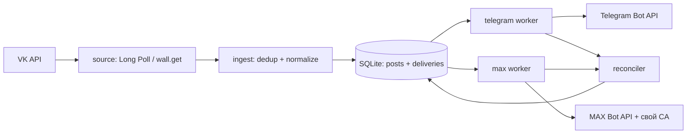

**Технический план реализации, редакция 4**

| | |
|---|---|
| Версия плана | 4.0 |
| База | ТЗ «Crosspost — VK → MAX + Telegram.md» v0.1 |
| Размещение | Docker на VDS, Нидерланды |
| Источник | VK, сообщество `227892646` (`dilerfavoritavto42`) |
| Статус | реализация прототипа: VK API, загрузчик медиа и проверка VK-видео подтверждены локально |


1. Приоритетная стратегия медиа изменена: по умолчанию сохраняем ссылку на исходную публикацию VK и не скачиваем/перезаливаем медиа без необходимости.
2. Скачивание медиа оставлено резервным сценарием для случаев, когда целевая площадка не может показать вложение по ссылке или требуется физическая копия файла.
3. На реальном VK-сообществе подтверждены `wall.get`, структура фото `photo.sizes` и получение метаданных видео через `video.get`.
4. Для фото подтверждена загрузка полного файла с CDN VK. Для видео подтверждено извлечение DASH MPD и HLS через `yt-dlp`; реальный MP4 успешно скачан в качестве до 720p.
5. `video.get.direct_url` уточнён: в проверенном случае это страница просмотра `vkvideo.ru`, а не прямой URL видеофайла.
6. В план добавлены `yt-dlp` и FFmpeg как зависимости резервного пути скачивания видео; включать их в основной runtime только при реализации/активации этого пути.
7. Принято решение по политике отбора: любое новое сообщение, без фильтра по содержанию.
8. VK использует **сервисный ключ с правами только на чтение**; ключ с правами записи не требуется.
9. Снят риск сборки альбомов: запись VK приходит одним объектом.
10. Хост рассматривается как «Docker + сеть».

---

## Содержание

1. Назначение и границы
2. Входные данные и статус проверки
3. Архитектура
4. Структура каталогов
5. Назначение модулей
6. Внешние зависимости и конфигурация
7. Этапы реализации
8. Риски и способы устранения
9. Быстрый переезд
10. Открытые вопросы
11. Приложение: реестр проверки API

---

## 1. Назначение и границы

VK — единственный первоисточник. Сервис обнаруживает новую публикацию сообщества и публикует её в канал MAX и канал Telegram. Один контейнер, одна очередь публикаций, четыре статуса доставки на площадку.

```
VK → Crosspost → MAX
              ↘ Telegram
```

**Обязательно по требованию заказчика:** перенос фотографий **и видео**, с сохранением оформления — переносы строк, ссылки, эмодзи, порядок медиа, репосты контентом оригинала.

**Политика отбора:** любое новое сообщение, без тематического фильтра.

**Автономность (жёсткое ограничение):** приложение не изменяет системные настройки сервера, firewall, маршрутизацию и системный CA bundle; не публикует входящих портов; не хранит секреты в образе.

---

## 2. Входные данные и статус проверки

### 2.1. Подтверждено официальной документацией

| Параметр | Значение | Источник |
|---|---|---|
| VK Long Poll покрывает активность на стене | да | dev.vk.com/ru/api/events/overview |
| `wall.get`: сервисный ключ; `count` ≤ 100; `domain` принимает короткий адрес | да | dev.vk.com/ru/method/wall.get |
| `wall.getById`: ≤ 100 ID; `copy_history_depth` для репостов | да | dev.vk.com/ru/method/wall.getById |
| Telegram: текст сообщения | 1–4096 символов | Bot API, `sendMessage` |
| Telegram: подпись к медиа | 0–1024 символа | Bot API, `InputMediaPhoto` |
| Telegram: альбом | 2–10 элементов, возвращает **массив** Message | Bot API, `sendMediaGroup` |
| Telegram: форматирование | MarkdownV2 / HTML: bold, italic, underline, strike, spoiler, blockquote, ссылки, pre/code | Bot API, Formatting options |
| MAX: текст | до 4000 символов | dev.max.ru, `NewMessageBody` |
| MAX: изображение | JPG/JPEG/PNG/GIF/TIFF/BMP/HEIC; ≤ 50 МБ **и** ≤ 7680×7680 — оба критерия | dev.max.ru, «Типы вложений» |
| MAX: видео | MP4/MOV/MKV/WEBM; ≤ 250 МБ | там же |
| MAX: вложений в сообщении | ≤ 12 | dev.max.ru, `POST /messages` |
| MAX: частота | ≤ 2 сообщения/сек в один чат | там же, «Ограничения» |
| MAX: медиа | `POST /uploads` → `token`; один файл на URL загрузки; **изображения можно по `url`, видео/аудио — нельзя** | dev.max.ru, `POST /uploads`; «Отправка сообщений с медиафайлами» |
| MAX: авторизация | только заголовок `Authorization` | dev.max.ru, «Обзор» |
| MAX: TLS | домен `platform-api2.max.ru`; требуется **сертификат Минцифры** в доверенных | dev.max.ru, «Обзор» |

### 2.2. Проверено на живом VK API и загрузке медиа

Проверки выполнены на стене сообщества `-227892646` с сервисным ключом только для чтения.

| Проверка | Фактический результат | Статус |
|---|---|---|
| `wall.get` | Возвращает записи сообщества; в `attachments[]` обнаружены фото, видео и ссылки | подтверждено |
| Фото | `photo.sizes` содержит варианты размеров и URL; выбор максимального по `width × height` работает | подтверждено |
| Фото CDN | Для фото `456245152` выбран вариант 1424×1920; CDN ответил JPEG и `Content-Range: bytes 0-0/866015`; полный файл затем успешно скачан | подтверждено |
| Видео | `video.get` по `owner_id`, `id` и `access_key` вернул метаданные; поле `files` в проверенном ответе отсутствовало | подтверждено для проверенного видео |
| `direct_url` | В проверенном случае ведёт на страницу `vkvideo.ru/video-227892646_456239081`, а не на MP4 | подтверждено |
| Извлечение потока | `yt-dlp --list-formats` обнаружил DASH MPD и HLS; доступны варианты до 1280×720 | подтверждено для проверенного видео |
| Скачивание видео | Команда `yt-dlp` с FFmpeg успешно скачала и объединила видео в MP4 | подтверждено для проверенного видео |
| Универсальный загрузчик | `MediaDownloader` прошёл unit-тесты фото, видео, HTTP 404, замены файла и сетевого обрыва; при обрыве старый файл сохраняется, временный удаляется | подтверждено тестами |

Подтверждение относится к конкретным проверенным записям и не доказывает одинаковое поведение всех типов видео, приватных записей или ограниченных по доступу материалов.

### 2.3. Остаётся гипотезой — проверяется на живом API

1. Имя и полная схема события создания записи на стене VK (Long Poll).
2. Универсальность схемы вложений для всех типов публикаций, включая `copy_history` и редкие типы attachments.
3. Предельная глубина `offset` в `wall.get`.
4. URL и отпечатки сертификатов Минцифры (Root CA + Sub CA).
5. Группировка нескольких медиа в один пост MAX.
6. Лимит частоты Telegram-бота.
7. Чтение истории канала Telegram ботом — метода не найдено; считать невозможным до доказательства обратного.
8. Поведение Telegram Bot API при передаче VK URL для разных типов медиа и ограничения размера/доступности таких URL.
9. Возможность стабильного скачивания всех поддерживаемых типов VK-видео через `yt-dlp` без дополнительных cookies/авторизации.

> **Правило:** пункты 2.3 не кодируются «по памяти». Этап, зависящий от гипотезы, начинается с записи реального ответа API или результата проверки в `docs/05-api-verification.md`.

### 2.4. Идентификаторы площадок (зафиксированы заказчиком)

| Назначение | Значение | Где в конфиге | Примечание |
|---|---|---|---|
| Сообщество VK, короткое имя | `dilerfavoritavto42` | `VK_GROUP_DOMAIN` | для `wall.get` (`domain=`) |
| Сообщество VK, числовой ID | `227892646` | `VK_GROUP_ID` | часть ключа дедупликации |
| Владелец стены VK | `-227892646` | вычисляется | `owner_id`, отрицательный ID сообщества |
| Канал MAX | `-72551466963518` | `MAX_CHAT_ID` | передаётся как `chat_id` |
| Канал Telegram | `-2259449277` | `TG_CHAT_ID` | передаётся как `chat_id` |

**Требует проверки (не блокирует этап 1):** формат Telegram-ID `-2259449277` не содержит префикса `-100…`, характерного для каналов и супергрупп; возможен вариант, что это базовая группа либо значение приведено не полностью. Аналогично `-72551466963518` — это ID чата MAX, а не его публичный адрес. Обе величины и права ботов администраторами подтверждаются на этапе 3–4 первым успешным `sendMessage`/`POST /messages`; результат — в `docs/05`.

**Требования к правам:** боты Telegram и MAX должны быть администраторами целевых чатов с правом публикации. Токены и ID — только в `.env` (права `600`); сами ID не являются секретом, но в репозиторий не выносятся.

---

## 3. Архитектура

### 3.1. Форма

Один контейнер, один процесс, один asyncio-loop. Компоненты общаются через SQLite (транзакционный outbox), а не напрямую.



**Приём поста и создание по строке-заданию на каждую площадку — одна транзакция.** Отправка — отдельный шаг, меняющий только свою строку. Отсюда независимость площадок (ТЗ §5.4) и защита от повторов (§6).

### 3.2. Источник VK

- Основной канал — **Long Poll** (подтверждено: покрывает активность на стене, не требует входящего порта).
- **Догон при старте** и при потере offset — `wall.get` с `domain=dilerfavoritavto42`, `count=100`, `offset` в пределах проверенной глубины.
- **Репосты** — `wall.getById` с `copy_history_depth=1`: контент берётся из оригинала, текст-надстройка идёт первым блоком.
- Callback не используется: требует публичного HTTPS-эндпоинта.
- **Запись VK приходит одним объектом.** Все вложения одной публикации находятся в одном элементе `items[]`.

### 3.3. Медиа и оформление

**Основная стратегия — ссылка на исходную публикацию VK.** VK остаётся хостингом оригинальных фотографий и видео. По умолчанию Crosspost не скачивает и не перезаливает медиа: в публикацию MAX/Telegram переносится текст с кликабельной ссылкой на исходный пост VK. Это снижает трафик, дисковую нагрузку, время обработки и риск несовместимости форматов.

Ссылка на VK — это ссылка на оригинальную публикацию, а не обещание, что целевая площадка встроит видео или покажет все вложения как нативные медиа. Предпросмотр/встраивание зависит от клиента и политики целевой площадки; его наличие не гарантируется.

| Сценарий | Telegram | MAX |
|---|---|---|
| Основной режим | Текст + ссылка на пост VK | Текст + ссылка на пост VK |
| Фото по прямому URL VK | Возможность передачи URL требует отдельной проверки на реальном Bot API; иначе резервная загрузка | Поддерживается `url` для изображений согласно документации MAX |
| Видео по прямому URL VK | Не считать гарантированным; при необходимости — резервная загрузка | Отправка видео по `url` не поддерживается; при необходимости — резервная загрузка |
| Резервное медиа | Скачать и загрузить через Bot API | Скачать, затем `POST /uploads` и отправить по `token` |

**Резервный путь скачивания:**

- Фото: взять лучший доступный вариант из `photo.sizes` и скачать потоково через `MediaDownloader`.
- Видео: использовать `yt-dlp` для извлечения DASH/HLS и скачивания; FFmpeg — для объединения раздельных аудио- и видеопотоков в MP4.
- `video.get.direct_url` нельзя считать прямой ссылкой на файл: в проверенном случае это страница просмотра VK.
- Резервный путь включается, если ссылка на оригинальный пост не удовлетворяет требованиям конкретного назначения, если требуется нативное вложение или если пользователь явно включил копирование медиа.
- При невозможности резервного скачивания/публикации сохранять ссылку на VK и фиксировать причину в логе; не терять сам пост.

Ограничения целевых API для резервного пути:

| | Telegram | MAX |
|---|---|---|
| Фото | URL или загрузка (URL-путь требует проверки для VK CDN) | **по `url`** (без скачивания) либо загрузка |
| Видео | скачивание → загрузка; прямой VK URL не считать гарантированным | скачивание → `POST /uploads` → `token` |
| Альбом | `sendMediaGroup`, 2–10 | одним постом, ≤ 12 вложений |
| Текст | 4096 | 4000 |
| Подпись | 1024 | — (текст в теле поста) |
| Оформление | MarkdownV2 / HTML | `format=markdown` или `html` |

Следствия, обязательные к реализации:

1. В нормальном режиме текст публикации дополняется ссылкой на оригинальный пост VK; скачивание медиа не запускается.
2. Ссылка на VK должна сохраняться в нормализованной модели как `source_url` и попадать в каждую целевую публикацию, в том числе при резервной отправке медиа.
3. Переключатель политики медиа должен поддерживать как минимум `link_only` (по умолчанию) и `download_fallback`.
4. Резервное скачивание должно быть потоковым и атомарным: временный файл `.part`, затем `os.replace`; при ошибке временный файл удаляется, существующий файл назначения не повреждается.
5. Альбом VK > 10 фото → несколько `sendMediaGroup`; > 12 медиа → несколько постов MAX, если выбран режим копирования медиа.
6. `sendMediaGroup` возвращает массив → в БД хранится **список** `remote_message_ids`.
7. Текст длиннее подписи (1024) при наличии фото → подпись + продолжение отдельным сообщением.
8. Изображение MAX валидируется **по двум критериям одновременно** (50 МБ и 7680×7680).
9. Видео > 250 МБ или в неподдерживаемом формате → публикация ссылки на пост VK с записью в лог, не тихий пропуск.
10. Видео требует **дискового** буфера: 250 МБ через tmpfs не проходит. tmpfs — только для мелочей и `/tmp`.
11. Лимит MAX 2 сообщения/сек в целевой чат — пауза ≥ 0,5 с между отправками, очередь.

### 3.4. Состояние и защита от дублей

- Ключ дедупликации: `UNIQUE(vk_group_id, vk_post_id)` — для сообщества `227892646`.
- Статусы — **ровно четыре**: `pending / processing / published / failed`. Неопределённый исход — **флаги** `outcome_uncertain`, `needs_review`, не пятый статус.
- Защита от второго экземпляра: атомарный захват `UPDATE ... WHERE status='pending' AND next_attempt_at<=now` с проверкой числа затронутых строк. `flock` на `data/.lock` — предохранитель на старте. Heartbeat — только диагностика.
- При старте единственного экземпляра все lease сбрасываются.
- Повторы: сетевые ошибки/5xx — повторяемые; `429` — по указанному интервалу; 4xx — сразу `failed`; экспоненциальный backoff с джиттером.

---

## 4. Структура каталогов

```
/opt/crosspost/
├── docker-compose.yml
├── Dockerfile                 # python:3-slim по digest, non-root
├── .env                       # секреты и ID, 600, вне git
├── .env.example
├── requirements.txt           # httpx, aiosqlite, pydantic-settings, yt-dlp; dev: pytest, ruff
├── README.md
├── docs/
│   ├── 01-architecture.md
│   ├── 02-operations.md
│   ├── 03-migration.md
│   ├── 04-runbook.md
│   └── 05-api-verification.md   # фактические ответы API, отпечатки сертификатов, ID
├── app/
│   ├── main.py
│   ├── config.py
│   ├── logging_setup.py
│   ├── models.py
│   ├── database.py
│   ├── migrations/0001_init.sql
│   ├── repositories/
│   │   ├── posts_repo.py
│   │   ├── deliveries_repo.py
│   │   └── state_repo.py
│   ├── sources/
│   │   ├── vk_client.py
│   │   ├── vk_longpoll.py
│   │   ├── vk_poller.py       # догон через wall.get
│   │   ├── vk_reposts.py      # wall.getById + copy_history
│   │   └── vk_normalizer.py
│   ├── publishers/
│   │   ├── base.py
│   │   ├── telegram_client.py
│   │   ├── max_client.py
│   │   ├── formatter.py
│   │   ├── media.py
│   │   └── errors.py
│   ├── pipeline/
│   │   ├── ingest.py
│   │   ├── dispatcher.py
│   │   ├── worker.py
│   │   └── reconciler.py
│   ├── http/
│   │   ├── client_factory.py
│   │   ├── tls.py             # SSLContext только для MAX
│   │   └── ratelimit.py
│   ├── ops/
│   │   ├── cli.py
│   │   ├── doctor.py
│   │   ├── backup.py
│   │   └── instance_lock.py
│   └── utils/
│       ├── time.py
│       └── redact.py
├── tests/
│   ├── unit/
│   ├── integration/
│   └── fixtures/
├── scripts/
│   ├── preflight.sh
│   ├── verify-tls.sh
│   ├── backup.sh
│   └── restore.sh
├── data/                      # crosspost.db, .lock, media/ (только резервные копии медиа, TTL)
├── certs/                     # max-chain.crt — read-only
└── logs/
```

---

## 5. Назначение модулей

| Модуль | Назначение | Ключевое ограничение |
|---|---|---|
| `main.py` | сборка компонентов, запуск, завершение по SIGTERM | без бизнес-логики |
| `config.py` | `.env` → типизированный конфиг, валидация, маскирование | только чтение окружения |
| `database.py` | единственное соединение-писатель, pragma, идемпотентные миграции | один писатель; `data/` на локальной ФС |
| `repositories/*` | весь SQL; не знают про HTTP | замена хранилища локализована |
| `vk_client.py` | запросы с сервисным ключом, коды ошибок | только чтение, только исходящие соединения |
| `vk_longpoll.py` | цикл событий, хранение offset, backoff | идемпотентность событий |
| `vk_poller.py` | догон через `wall.get`, пагинация по 100 | предел глубины — из конфига |
| `vk_reposts.py` | `wall.getById`, `copy_history_depth=1` | контент оригинала |
| `vk_normalizer.py` | текст, вложения, `source_url`, репосты | необработанное сохраняется целиком |
| `ingest.py` | дедупликация + `posts` + `deliveries` в одной транзакции | повтор не создаёт записей |
| `dispatcher.py` | захват задач по lease, параллелизм на площадку | задача не выдаётся дважды |
| `worker.py` | «взять → отправить → записать», классификация ошибок | изоляция площадок |
| `reconciler.py` | `next_attempt_at`, снятие зависших lease, лимит попыток | параметры в конфиге |
| `publishers/base.py` | контракт публикатора | новая площадка = новый модуль |
| `formatter.py` | экранирование, MarkdownV2/HTML, markdown MAX, разбиение 4096/4000, подпись 1024 | лимиты — константы из §2.1 |
| `media.py` | политика `link_only` / `download_fallback`, выбор размера фото, резервное скачивание фото/видео, `POST /uploads`, кэш `token` | по умолчанию только ссылка VK; при копировании — валидация 50 МБ **и** 7680²; ≤ 250 МБ |
| `http/tls.py` | `SSLContext` из `certs/` только для MAX | системный CA не читается и не меняется |
| `ops/doctor.py` | БД, CA, TCP/TLS до API, права ботов, состояние очереди | только чтение |
| `ops/backup.py` | online-backup SQLite + `.env` + `certs/` + версия схемы | не `cp` живой БД |

---

## 6. Внешние зависимости и конфигурация

**Платформа:** Docker Engine, Compose v2 на VDS (NL), Ubuntu 24.04.5 LTS.

**Образ:** `python:3-slim` по digest; пакеты только внутри образа, установок на хост нет.

**Python (HTTP-клиент — `httpx`; извлечение VK-видео — отдельный инструмент резервного пути):**

- `httpx` — выбран из-за явного `SSLContext` на клиент (требование отдельного CA для MAX);
- `aiosqlite` либо `sqlite3` в выделенном потоке;
- `pydantic-settings`;
- `yt-dlp` — только резервное извлечение и скачивание VK-видео; не заменяет `httpx` для API и обычных загрузок;
- FFmpeg — системный бинарный компонент внутри Docker-образа, нужен для объединения DASH-аудио и видео в MP4;
- `pytest`, `pytest-asyncio`, `respx`, `ruff` — dev.

**Исключено намеренно:** `pyrogram` (требует MTProto-сессию аккаунта; для Bot API не нужен), `vk_api` (синхронная обёртка, не сочетается с asyncio), `requests` (блокирует event loop; дублирует `httpx`).

**Сервисы:** `api.vk.com`, `pu.vk.com`, `api.telegram.org`, `platform-api2.max.ru`. Все соединения исходящие, входящих портов нет.

**Криптоматериал:** `certs/max-chain.crt` = публичный набор + `Russian Trusted Root CA` + `Russian Trusted Sub CA`. Провенанс, дата, sha256 — в `docs/05`.

**Переменные `.env`:**

| Переменная | Назначение |
|---|---|
| `VK_SERVICE_TOKEN` | сервисный ключ, только чтение |
| `VK_GROUP_ID` | `227892646` |
| `VK_GROUP_DOMAIN` | `dilerfavoritavto42` |
| `TG_BOT_TOKEN` | токен Telegram-бота |
| `TG_CHAT_ID` | `-2259449277` |
| `MAX_BOT_TOKEN` | токен MAX-бота |
| `MAX_CHAT_ID` | `-72551466963518` |
| `MAX_CA_FILE` | `certs/max-chain.crt` |
| `DB_PATH`, `LOG_DIR`, `MEDIA_DIR` | пути в томах |
| `TEXT_LIMIT_*`, `MEDIA_MAX_*`, `RATE_*` | лимиты из §2.1 |
| `RETRY_*`, `BACKFILL_DEPTH` | повторы и глубина догона |

Токен MAX передаётся заголовком `Authorization` — в URL и логи не попадает.

---

## 7. Этапы реализации

Предварительная проверка окружения выполнена, этап 0 сокращён до фиксации результата.

| # | Этап | Содержимое | Критерий приёмки |
|---|---|---|---|
| 0 | Фиксация preflight | в `docs/02`, `docs/05`: Docker, место, доступность 4 API, исходящий IP контейнера, цепочка MAX из контейнера, подтверждение ID из §2.3 | отчёт есть; на хосте ничего не изменено |
| 1 | Скелет | Dockerfile, compose без `ports:`, non-root, `read_only` + tmpfs `/tmp` + тома, конфиг, логгер, БД + миграция, `doctor`, instance-lock | контейнер стартует, миграция идемпотентна, `doctor` проходит |
| 2 | Приём VK | `vk_client`, Long Poll, `vk_poller`, `vk_normalizer`, `ingest`, дедупликация | пост сообщества `227892646` появляется в БД ровно один раз; перезапуск не дублирует |
| 3 | Telegram: текст | клиент, `formatter`, worker, dispatcher | текст опубликован в `-2259449277`, `remote_message_id` записан, 4096 соблюдается |
| 4 | MAX: текст + TLS | `max_client`, `tls.py`, `certs/`, `verify-tls.sh`, пауза 0,5 с | публикация в `-72551466963518` проходит; системный CA не изменён; без CA — явная ошибка |
| 5 | Медиа | ссылка на оригинальный пост VK по умолчанию; резервное копирование фото через httpx и видео через yt-dlp + FFmpeg; загрузка в TG/MAX только при необходимости; альбомы 2–10 / ≤12 | ссылка сохраняется всегда; резервный режим проверен на реальных фото/видео; порядок медиа сохраняется |
| 6 | Надёжность | lease, reconciler, backoff, `failed`/флаги, `cli retry/replay/status` | отказ MAX не влияет на Telegram; kill -9 не даёт дубля |
| 7 | Быстрый переезд | `backup.py`, `restore.sh`, `docs/03`, контрольная миграция | переезд по §9 воспроизводится без правки кода |

Параллелится: 3 и 4 после 2; 5 требует 3 и 4; 6 доводится после 5.

---

## 8. Риски и способы устранения

| Риск | Устранение |
|---|---|
| **MAX: ошибка цепочки сертификатов** (`unable to get local issuer certificate`, code 20) | Отдельный bundle в `certs/`, ro-mount, `SSLContext` только для MAX. Системный CA и `update-ca-certificates` не трогать. `verify=False` запрещён |
| **Сертификат Минцифры не подтверждён по URL** | Закрывается до этапа 4; `doctor` сверяет отпечаток и срок действия |
| **Неверный формат ID или отсутствие прав бота** | Первый `sendMessage`/`POST /messages` на этапах 3–4; при ошибке прав — сообщение в лог с указанием, что требуется роль администратора |
| **Дубликаты при потере ответа** | `UNIQUE`-ключ; отдельные `deliveries`; lease; флаги вместо слепого повтора. Для Telegram программное восстановление невозможно — ручная сверка в runbook |
| **Второй экземпляр при переезде** | Атомарный захват; `flock`; heartbeat как диагностика; в `docs/03` шаг «остановить старый и подтвердить отсутствие пульса» |
| **Видео 250 МБ и память** | скачивание выключено по умолчанию; для резервного пути — `data/media/` с лимитом и TTL; `mem_limit`; потоковая передача |
| **Неизвестное имя события VK** | Этап 2 начинается с записи реального ответа Long Poll в `docs/05`; при расхождении правится только `sources/` |
| **Пропуск постов при простое** | `ts` в БД; догон через `wall.get` в проверенной глубине; за пределами — статус в CLI и ручное решение |
| **Разные лимиты площадок** | 4096 / 4000, 1024 подписи, 2–10 и ≤12 вложений, 2 сообщения/сек — константы и тесты |
| **Рост SQLite / конкуренция** | WAL, один писатель, `busy_timeout`, backup через online API |
| **Утечка токенов** | `redact` в логгере, `Authorization` вместо query, `.env` 600, секретов в образе нет |
| **Лавина публикаций** | Точка отсчёта — момент запуска (§10.1); при массовом появлении записей — последовательная отправка с паузой |
| **Ограничение архитектуры** | Реакция на события MAX требует Webhook → публичный эндпоинт. В текущей модели не нужна |

---

## 9. Быстрый переезд

**Что обеспечивает скорость:** всё состояние в трёх переносимых каталогах (`data/`, `certs/`, `.env`); образ по digest; отсутствие зависимостей от настроек хоста; отсутствие входящих портов.

**Процедура (целевое время — до 15 минут):**

1. На новом сервере: Docker + Compose, создать `/opt/crosspost`.
2. На старом: `docker compose stop` → `ops backup` → убедиться, что heartbeat не обновляется.
3. Перенести архив (`data/`, `certs/`, `.env`, compose, `docs/`).
4. На новом: распаковать, выставить владельца UID/GID, `docker compose up -d`.
5. `ops doctor` → БД, CA, TCP/TLS до 4 API, права ботов; затем `ops status`.
6. Старый экземпляр **не запускать**.

Проверка самой процедуры — отдельный прогон на копии до приёмки этапа 7.

---

## 10. Открытые вопросы

1. **Точка отсчёта.** Принято: только новые записи, история не публикуется, существующая стена индексируется без отправки. Требует подтверждения.
2. **Редактирование поста в VK** — отражать в каналах или игнорировать?
3. **Удаление поста в VK** — удалять в каналах или оставлять?
4. **Репосты с чужих стен** — контентом оригинала (текущее решение) или как есть?
5. **Резервное копирование медиа** — в каких случаях автоматически включать скачивание и загрузку вместо режима `link_only`? Текущий режим по умолчанию — ссылка на оригинальный пост VK.
6. **`parse_mode` Telegram** — MarkdownV2 или HTML, после теста на реальном тексте.
7. **Источник сертификатов Минцифры** и процедура ротации.
8. **Лимит частоты Telegram** — принять практическое значение как решение, не как факт документации.

> **Не считать установленным:** имя события стены VK, схема вложений `items[]`, глубина `offset`, группировка медиа в MAX, лимит частоты Telegram, чтение истории канала ботом, официальный URL сертификатов Минцифры, точный формат Telegram-ID `-2259449277`.

---

## 11. Приложение: реестр проверки API

### 11.1. Подтверждено — формулировки и разделы

| Пункт | Формулировка | Документ, раздел |
|---|---|---|
| Long Poll и стена | «Callback API и Bots Long Poll API поддерживают события, связанные с сообщениями сообщества, активностью пользователей на стене» | «События пользователей и сообществ», dev.vk.com/ru/api/events/overview |
| Callback требует адрес | «укажите и подтвердите конечный адрес сервера»; ответ `ok` + HTTP 200 | «Callback API», dev.vk.com/ru/api/callback/getting-started |
| `wall.get` | «можно использовать: ключ доступа пользователя • сервисный ключ доступа»; `count` — «Максимальное значение: 100»; `domain` — «Короткий адрес пользователя или сообщества» | dev.vk.com/ru/method/wall.get |
| `wall.getById` | «Максимум 100 идентификаторов»; `copy_history_depth` — «Определяет размер массива `copy_history`… если запись является репостом» | dev.vk.com/ru/method/wall.getById |
| Бот и каналы TG | «All messages from channels where they are a member» | Bots FAQ, core.telegram.org/bots/faq |
| Текст TG | «1-4096 characters after entities parsing» | `sendMessage` |
| Подпись TG | «0-1024 characters after entities parsing» | `InputMediaPhoto` |
| Альбом TG | «must include 2-10 items»; «returns an Array of Message objects» | `sendMediaGroup` |
| Форматирование TG | bold, italic, underline, strikethrough, spoiler, blockquote, инлайн-ссылки, pre/code; MarkdownV2 и HTML | «Formatting options» |
| Текст MAX | «до 4000 символов» | `NewMessageBody` |
| Вложения MAX | `image` — «до 50 МБ или не более 7680 × 7680 px — должны выполняться оба критерия»; `video` MP4/MOV/MKV/WEBM «до 250 МБ» | «Типы вложений» |
| Число вложений MAX | «Общее количество вложений не должно превышать общее ограничение — 12» | `POST /messages` |
| Частота MAX | «не более двух сообщений в секунду в один диалог, групповой чат или канал» | `POST /messages`, «Ограничения» |
| Загрузка MAX | «По URL-ссылке… можно загрузить только один файл» | `POST /uploads` |
| Медиа MAX по URL | «Для изображений… можно использовать `url`… Для аудио, видео и других файлов отправка по url недоступна» | «Отправка сообщений с медиафайлами» |
| Авторизация MAX | «Передача токена через query-параметры больше не поддерживается — используйте заголовок `Authorization`» | dev.max.ru/docs-api, «Обзор» |
| TLS MAX | «направляйте запросы на домен `platform-api2.max.ru`… добавили сертификат Минцифры в список доверенных» | dev.max.ru/docs-api, «Обзор» |
| Long Poll MAX | «не подходит для production-окружения. Рекомендуем… использовать Webhook» | объект `Update` |

### 11.2. Требует реального API

1. Числовой ID сообщества и подтверждение доступа сервисного ключа к стене `dilerfavoritavto42`.
2. Имя и схема события создания записи на стене VK.
3. Полная схема `items[]` для всех типов вложений и `copy_history`; для проверенного видео `video.get` вернул метаданные, но не `files`.
4. Предельная глубина `offset` в `wall.get`.
5. Точный формат и права для `TG_CHAT_ID` `-2259449277` и `MAX_CHAT_ID` `-72551466963518`.
6. Официальный URL сертификатов Минцифры и отпечатки.
7. Группировка медиа в MAX и её лимиты.
8. Официальный лимит частоты запросов к API MAX (не к чату) и Telegram-бота.

### 11.3. Источники

- dev.vk.com/ru/api/events/overview
- dev.vk.com/ru/api/callback/getting-started
- dev.vk.com/ru/api/community-events/json-schema
- dev.vk.com/ru/method/wall.get
- dev.vk.com/ru/method/wall.getById
- core.telegram.org/bots/faq
- core.telegram.org/bots/api — `sendMessage`, `sendMediaGroup`, `InputMediaPhoto`, Formatting options
- dev.max.ru/docs-api — «Обзор»
- dev.max.ru/docs-api/methods/POST/messages
- dev.max.ru/docs-api/methods/POST/uploads
- dev.max.ru/docs-api/use-cases/sending-messages/attachment-types
- dev.max.ru/docs-api/use-cases/sending-messages/media
- dev.max.ru/docs-api/use-cases/sending-messages/text-formatting
- dev.max.ru/docs-api/objects/NewMessageBody
- dev.max.ru/docs-api/objects/Update

---

**Итог ред. 4:** все три площадки адресуемы (VK `227892646`, Telegram `-2259449277`, MAX `-72551466963518`); архитектура outbox сохранена; VK работает через сервисный ключ только для чтения; проверены получение фото и извлечение/скачивание конкретного видео; основная стратегия медиа — ссылка на оригинальный пост VK, скачивание оставлено резервным путём. Восемь открытых вопросов §10 блокируют только этапы 5–7, не этап 1.

## 11.4. Проверка медиа на реальных данных (ноябрь 2026)

Проверены конкретные объекты сообщества `227892646`:

- Фото: `PHOTO_ID=456245152`. Выбран размер 1424×1920 с CDN VK; предварительный запрос Range подтвердил JPEG и полный размер 866 015 байт; полный файл успешно скачан.
- Видео: `VIDEO_ID=456239081`, `owner_id=-227892646`. `video.get` вернул метаданные и `direct_url`, но `direct_url` оказался страницей просмотра, не MP4.
- `yt-dlp --list-formats https://vkvideo.ru/video-227892646_456239081` обнаружил DASH MPD и HLS, отдельные аудио/видеопотоки и варианты до 1280×720.
- Реальное скачивание и объединение потоков в MP4 прошло успешно; для объединения использовался FFmpeg.
- Unit-тесты `MediaDownloader`: фото, видео, HTTP 404, замена существующего файла и сетевой обрыв. При ошибке частичная загрузка не заменяет существующий файл.

Эти результаты подтверждают техническую возможность резервного скачивания, но не меняют приоритетную политику `link_only`. Проверка одного видео не гарантирует работу `yt-dlp` для каждого ролика VK.

### 12 Env
[.env проекта](<file:///C:/Obsidian/KnowledgeBase/99 Attachments/Crosspost/.env>)

```dotenv
# VK — сервисный ключ только для чтения
VK_SERVICE_TOKEN=
VK_GROUP_ID=227892646
VK_GROUP_DOMAIN=dilerfavoritavto42
VK_API_VERSION=5.199

# Telegram Bot API
TG_BOT_TOKEN=
TG_CHAT_ID=-1002259449277

# MAX Bot API
MAX_BOT_TOKEN=
MAX_CHAT_ID=-72551466963518
MAX_API_BASE=https://platform-api2.max.ru
# Путь к официально полученной цепочке сертификатов Минцифры.
# Пока файл не добавлен, используется системное хранилище CA.
MAX_CA_FILE=certs/russian_trusted_root_ca.crt

HTTP_TIMEOUT_SECONDS=20
```dotenv
